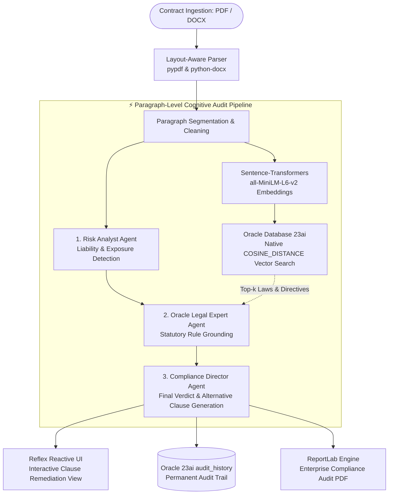

<div align="center">

# ⚖️ B2B Compliance Auditor — Oracle 23ai & LangGraph
### Autonomous Multi-Agent Contract Auditing & Legal Risk Remediation Engine

[](https://python.org)
[](https://reflex.dev/)
[](https://langchain-ai.github.io/langgraph/)
[](https://www.oracle.com/database/23ai/)
[](https://ollama.ai)
[](#)

<p align="center">
  <a href="#-executive-summary">Executive Summary</a> •
  <a href="#-end-to-end-system-architecture">System Architecture</a> •
  <a href="#-the-3-tier-langgraph-agent-topology">Agent Topology</a> •
  <a href="#-oracle-23ai-ai-vector-search-engine">Oracle 23ai Subsystem</a> •
  <a href="#-remediation--alternative-clause-synthesis">Remediation Engine</a>
</p>

</div>

---

## 📌 Executive Summary

Manual legal review of commercial agreements (SLA contracts, NDAs, Master Service Agreements, SaaS terms) represents an acute operational bottleneck for enterprise legal and procurement departments. In-house counsels routinely face massive document backlogs, escalating legal liabilities, and tightening compliance mandates under the **EU AI Act**, **GDPR (DSGVO)**, and national civil codes (e.g., **§§ 305 ff. BGB**).

The **B2B Compliance Auditor** is an autonomous, multi-agent contract audit platform built on a pure-Python stack using **Reflex** and **LangGraph**. It ingests raw legal documents (PDF/DOCX), segments them into contextual clauses, and executes paragraph-level compliance validation against a local statutory knowledge base hosted on **Oracle Database 23ai AI Vector Search**.

Beyond passive risk classification, the system acts as an **Actionable Legal Copilot**: for every non-compliant or hazardous clause, it automatically synthesizes a legally grounded, drop-in replacement clause (**Alternativklausel**) and compiles a court-ready audit report via **ReportLab**.

---

## 🏛️ End-to-End System Architecture

The pipeline processes contracts through an asynchronous event loop, coupling layout-aware document extraction, dense embeddings, high-performance database vector indexing, and multi-agent synthesis:


---

## 🧠 The 3-Tier LangGraph Agent Topology

The cognitive core abandons single-prompt evaluation in favor of a specialized **LangGraph StateGraph** actor chain. Each node enforces isolated roles and explicit state contracts (`AgentState`):

### 1. Risk Analyst Agent (`risk_analyst_node`)
* **Objective:** Acts as corporate commercial counsel. Scans contract clauses strictly for financial, operational, and indemnification exposures.
* **Scope:** Evaluates unreasonable liability caps, unilateral termination rights, ambiguous delivery acceptance criteria, and penalty mechanisms.
* **Output Constraint:** Concise, 2-sentence empirical assessment.

### 2. Legal Compliance Expert (`oracle_legal_node`)
* **Objective:** Regulatory verification grounded in real statutory law.
* **Context Ingestion:** Consumes the raw contract text, the findings of the Risk Analyst, and the top-3 statutory vector chunks retrieved from Oracle 23ai.
* **Evaluation:** Correlates the factual clause against real legal standards (e.g., General Terms & Conditions control under *§ 307 BGB*, data processing mandates under *Art. 28 GDPR*, transparency duties under *Art. 13 EU AI Act*).

### 3. Compliance Director (`compliance_director_node`)
* **Objective:** Executive arbiter synthesizing the final legal risk rating and actionable remediation.
* **Deterministic Classification:**
  * **`RISK / RISIKO`:** Material statutory violation or critical commercial liability exposure.
  * **`NOTICE / HINWEIS`:** Soft contractual imbalance or optimization opportunity without direct illegality.
  * **`COMPLIANT / KONFORM`:** Fully aligned with prevailing legal doctrine.
* **Active Remediation:** If a clause poses a risk, the agent generates a contract-grade replacement clause ready to paste into counter-negotiations.
* **Structured Output:** Emits strictly validated JSON parsing directly into Reflex state models.

---

## 🗄️ Oracle 23ai AI Vector Search Engine

While most enterprise prototypes rely on isolated vector engines, this platform leverages **Oracle Database 23ai**, unifying operational transaction processing and high-dimensional semantic search in a single enterprise database tier:

### 1. Native Vector Architecture
* Knowledge vectors are stored directly in an Oracle `VECTOR(384, FLOAT32)` column inside the `compliance_knowledge` table on the `USERS` tablespace.
* Embeddings are generated locally via `all-MiniLM-L6-v2` (`sentence-transformers`), guaranteeing privacy and low inference overhead.

### 2. High-Performance Cosine Distance Retrieval
* Uses thin-mode driver connectivity (`oracledb`) without requiring heavy Oracle Client runtime dependencies.
* Queries execute native vectorized distance operations directly inside Oracle SQL:
  ```sql
  SELECT id, text_chunk, COSINE_DISTANCE(embedding, :query_vec) AS distance
  FROM compliance_knowledge
  ORDER BY distance ASC
  FETCH FIRST :top_k ROWS ONLY;
  ```

### 3. Pre-Indexed Statutory Database
The ingestion subsystem (`import_laws.py`) chunks, vectors, and indexes complete regulatory corpuses:
* **GDPR / DSGVO** (General Data Protection Regulation)
* **EU AI Act** (Artificial Intelligence Regulation)
* **BGB** (German Civil Code — AGB-Recht / Contract Law)
* **ISO/IEC 27001:2022** (Information Security Controls)

---

## 🛡️ Remediation & Alternative Clause Synthesis

The system resolves the primary friction point of automated legal review: **identifying a problem without providing a solution**.

When an offending clause is flagged, the engine drafts an alternative clause (*Alternativklausel*) balancing commercial interest with statutory validity:

| Problematic Contract Clause | Detected Legal Exposure | Generated Alternative Clause (Drop-In) |
| :--- | :--- | :--- |
| *"The Contractor's liability for slight negligence is excluded across all claims without exception."* | Violation of § 309 Nr. 7 BGB & § 307 BGB (unreasonable restriction of essential contractual obligations). | *"Die Haftung für einfache Fahrlässigkeit ist ausgeschlossen, es sei denn, es handelt sich um die Verletzung wesentlicher Vertragspflichten (Kardinalpflichten) oder um Schäden aus der Verletzung des Lebens, des Körpers oder der Gesundheit."* |
| *"Customer grants Vendor perpetual, royalty-free rights to utilize all uploaded data for AI model training."* | Breach of GDPR Article 5(1)(b) (Purpose limitation) & Article 28 (Processor obligations). | *"Der Auftragnehmer darf Kundendaten ausschließlich zur Erbringung der vertragsgegenständlichen Leistungen verarbeiten. Eine Nutzung zu eigenen Trainings- oder Weiterentwicklungszwecken von KI-Modellen ist ausgeschlossen."* |


---

## 🛠️ Enterprise Tech Stack

| Component | Technology | Role & Architectural Specifications |
| :--- | :--- | :--- |
| **Full-Stack Application** | **Reflex 0.9+** | Pure Python reactive UI runtime, asynchronous event loop & Tailwind CSS integration |
| **Agentic Workflow** | **LangGraph** | Stateful multi-agent graph with deterministic transitions (`StateGraph`) |
| **Vector Database** | **Oracle Database 23ai** | Native `VECTOR(384, FLOAT32)` storage with in-database cosine distance indexing |
| **Database Driver** | **python-oracledb** | High-performance Thin Mode driver (no Oracle Instant Client binaries required) |
| **Dense Embeddings** | **Sentence-Transformers** | Local execution of `all-MiniLM-L6-v2` generating 384-dimensional dense vectors |
| **LLM Inference** | **Ollama & OpenAI** | Dual-mode switch: Local `qwen2.5-coder:14b` (privacy) or Cloud `gpt-4o-mini` |
| **Document Ingestion** | **PyPDF & python-docx** | Layout-mode PDF text reconstruction and paragraph-level segmentation |
| **Enterprise PDF Export**| **ReportLab 4.x** | Custom corporate-palette layout, automated disclaimers, and audit matrix styling |

---

## 📂 Repository Topology

```text
compliance_auditor/
├── compliance_auditor/           # Core Application Package
│   ├── __init__.py
│   ├── compliance_auditor.py     # Reflex UI entry point, reactive State & async coordinator
│   ├── ai_engine.py              # LangGraph multi-agent pipeline (Risk, Legal, Director)
│   ├── oracle_db.py              # Oracle 23ai thin-mode vector retrieval & audit logging
│   ├── file_parser.py            # Layout-aware PDF and DOCX clause segmentation parser
│   └── pdf_generator.py          # Corporate ReportLab PDF generator with legal disclaimer
│
├── compliance_source_pdfs/       # Statutory Knowledge Base (GDPR, EU AI Act, BGB, ISO 27001)
├── assets/                       # Static assets, branding logo & downloadable generated PDFs
├── import_laws.py                # Pre-indexing batch pipeline: PDF extraction → 384d vector → Oracle 23ai
├── rxconfig.py                   # Reflex project configuration (Tailwind & Sitemap plugins)
├── requirements.txt              # Production dependency lockfile
└── AGENTS.md                     # Reflex agent development skill contracts & system rules
```

---

## ⚡ Quickstart & Deployment

### Prerequisites
* **Python 3.11+**
* **Oracle Database 23ai** (e.g., Oracle 23ai Free running locally via Docker or OCI instance)
* **Ollama** running locally with `qwen2.5-coder:14b` *(or an active `OPENAI_API_KEY`)*

---

### 1. Clone & Install Dependencies

```bash
# Clone repository
git clone https://github.com/your-username/b2b-compliance-auditor.git
cd b2b-compliance-auditor

# Create and activate Python virtual environment
python -m venv venv
source venv/bin/activate  # On Windows: venv\Scripts\activate

# Install application dependencies
pip install -r requirements.txt
pip install oracledb sentence-transformers pypdf python-docx reportlab langgraph langchain-openai
```

---

### 2. Configure Oracle Database 23ai

Ensure your Oracle 23ai instance is accessible (Default service: `localhost:1521/FREEPDB1`). Execute the initial schema setup:

```sql
-- Connect as SYSTEM or privileged database user
CREATE SEQUENCE compliance_knowledge_seq START WITH 1 INCREMENT BY 1 NOCACHE;
CREATE SEQUENCE audit_history_seq        START WITH 1 INCREMENT BY 1 NOCACHE;

-- Create Vector Knowledge Table
CREATE TABLE compliance_knowledge (
    id          VARCHAR2(100) DEFAULT SYS_GUID() PRIMARY KEY,
    source_file VARCHAR2(255),
    chunk_index NUMBER,
    chunk_text  CLOB,
    embedding   VECTOR(384, FLOAT32)
) TABLESPACE USERS;

-- Create Permanent Audit Ledger
CREATE TABLE audit_history (
    id              NUMBER DEFAULT audit_history_seq.NEXTVAL PRIMARY KEY,
    timestamp       TIMESTAMP DEFAULT SYSTIMESTAMP NOT NULL,
    document_name   VARCHAR2(512) NOT NULL,
    paragraph_text  CLOB NOT NULL,
    risk_level      VARCHAR2(50) NOT NULL,
    recommendations CLOB
);
```

---

### 3. Ingest Statutory Regulatory Documents

Place your target regulatory guidelines (e.g., GDPR, EU AI Act, BGB) as PDFs into `compliance_source_pdfs/` and run the vector ingestion pipeline:

```bash
# Embeds and uploads all legal corpora into Oracle 23ai Vector Store
python import_laws.py
```
> Outputs chunk count and vector verification confirmations directly to stdout.

---

### 4. Launch the Reflex Full-Stack Web Application

```bash
# Initialize Reflex runtime environment
reflex init

# Start local development server (Frontend + Backend)
reflex run
```
> Access the dark-mode interactive auditing suite at `http://localhost:3000`.

---

## 📄 Corporate Audit PDF Generation (ReportLab)

For board governance and legal defense documentation, `pdf_generator.py` compiles audit sessions into archival PDF records:

* **Executive Risk Distribution:** Automated frequency breakdown across all identified liability tiers (`Risk`, `Notice`, `Compliant`).
* **Statutory Reference Traceability:** Each flagged paragraph explicitly cross-references the matching legal paragraph (e.g., *§ 307 BGB*, *GDPR Art. 28*).
* **Remediation Callouts:** Highlights alternative clause recommendations in distinct corporate container panels for direct contract counter-drafting.
* **Legal Disclaimer Banner:** Enforces automated legal disclaimers on every page template to comply with professional AI liability standards.

---

## 👨‍💻 Engineering & Systems Architecture

Architected by **Elvijs Landmans** ([landmansIT](https://landmansit.de)).

* **Enterprise Database Convergence:** Harnessing native vector operations within battle-tested relational engines (**Oracle 23ai**) rather than maintaining fragmented database architectures.
* **Deterministic Role Separation:** Enforcing strict agent boundaries via **LangGraph** to eliminate conversational drift in high-liability domains.
* **Prescriptive AI (Beyond Classification):** Transforming AI from a passive warning tool into an active legal draftsman via synthesized alternative clauses.

---

## 📄 License

Proprietary Software. All Rights Reserved. Developed for corporate legal departments, procurement hubs, and enterprise governance workflows.
